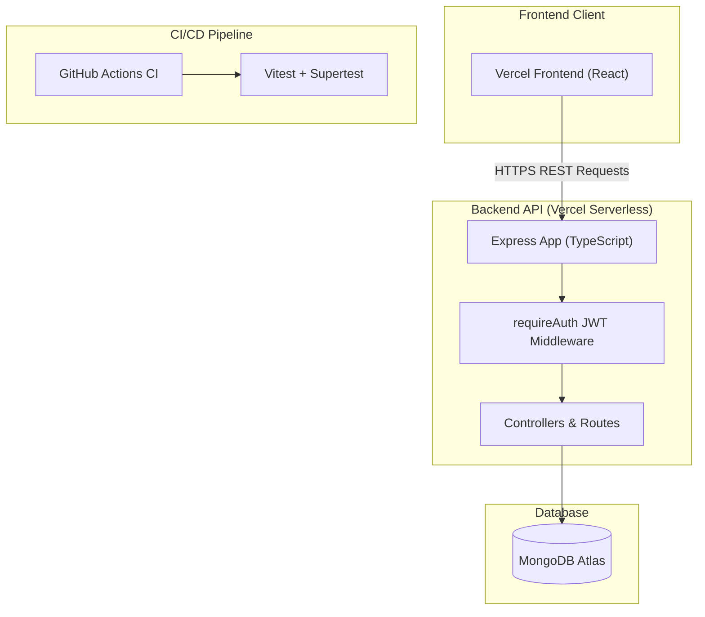

[](https://github.com/Drei-Nitsu/itelect4-backend/actions/workflows/ci.yml)

# itelect4-backend

Backend REST API for **IT Elective 4 (Full Stack Web Development & Modern DevOps)**. Built with Node.js, Express, TypeScript, Mongoose, and MongoDB Atlas. Deployed as a serverless function on **Vercel**.

---

## 🌐 Live Deployment Links
- **Live Backend API**: [https://itelect4-backend-beryl.vercel.app](https://itelect4-backend-beryl.vercel.app)
- **Live Frontend App**: [https://itelect4-project-beta.vercel.app](https://itelect4-project-beta.vercel.app)

---

## 📖 About the API
This backend provides the core authentication, course data, project submissions, and automated code review capabilities:
- **Authentication**: JWT issuance and verification (`/api/auth/register`, `/api/auth/login`).
- **Course Catalog**: Public reference routes for academic courses (`/api/courses`).
- **Submissions Management**: Authenticated CRUD endpoints for project repository submissions (`/api/submissions`).
- **AI Review Integration (GT5)**: Endpoints evaluating submitted GitHub projects and providing automated feedback.
- **Automated Testing & CI (GT6)**: Supertest suite validating route authentication (`requireAuth` 401 with no token, 200 with valid token) and GitHub Actions CI.

---

## 🏛️ Architecture Diagram



---

## 🛠️ Tech Stack
- **Runtime & Framework**: Node.js, Express
- **Language**: TypeScript
- **Database**: MongoDB Atlas with Mongoose ODM
- **Authentication**: JSON Web Tokens (JWT) & bcryptjs
- **Testing**: Vitest, Supertest
- **Deployment**: Vercel Serverless Functions

---

## 🚀 How to Run Locally

### 1. Prerequisites
- Node.js `v22.12` or newer
- MongoDB Atlas cluster or local MongoDB instance

### 2. Clone the Repository
```bash
git clone https://github.com/Drei-Nitsu/itelect4-backend.git
cd itelect4-backend
```

### 3. Install Dependencies
```bash
npm install
```

### 4. Configure Environment Variables
Create a `.env` file in the root directory:
```env
PORT=4000
MONGODB_URI=your_mongodb_connection_string
JWT_SECRET=your_jwt_secret_key
CORS_ORIGIN=http://localhost:5173,https://itelect4-project-beta.vercel.app
```

### 5. Seed Reference Data
```bash
npm run seed
```

### 6. Run Server & Tests
```bash
# Start development server
npm run dev

# Run Supertest integration tests
npm test

# Build for production
npm run build
```

---

## 🤖 AI-Use Disclosure
In compliance with the course syllabus and institutional AI usage policies:
- **AI Coding Assistants**: Google Antigravity (Gemini & Claude) was utilized for code structuring, drafting tests with Supertest, and setting up CI workflows.
- **Verification & Ownership**: All API logic, schema design, and tests were verified, tested, and validated by the student.
